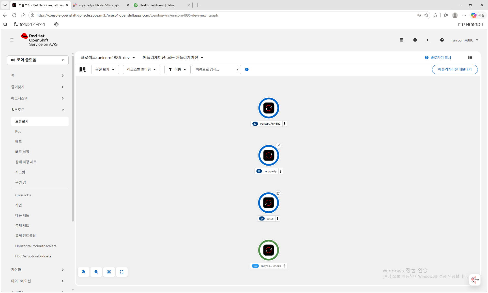
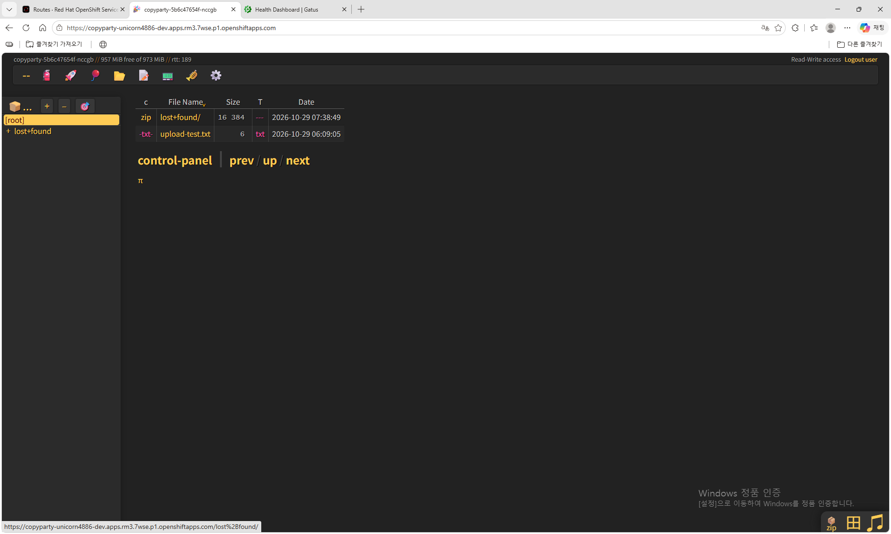
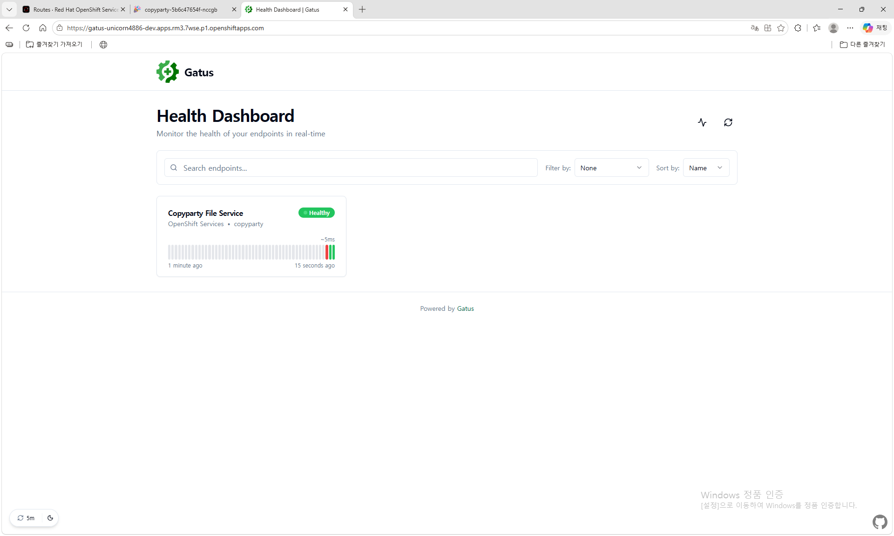
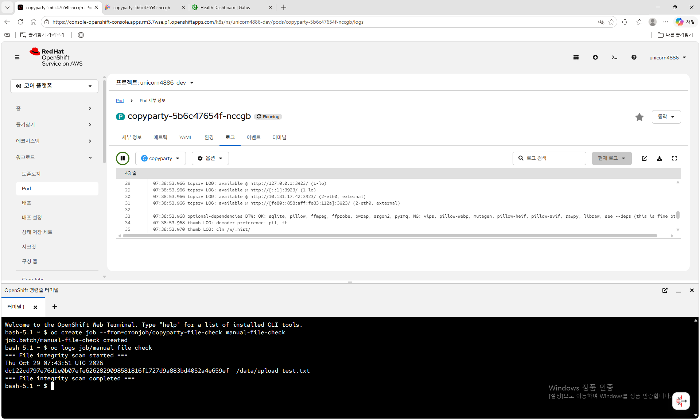

# Copyparty 파일 공유 및 상태 모니터링 서비스

> **과목:** 지능형IoT플랫폼 — 나만의 컨테이너 만들기  
> **학번:** 202355703  
> **배포 환경:** Red Hat OpenShift Developer Sandbox  
> **최종 재배포 검증:** 2026-10-29 (`unicorn4886-dev` 프로젝트)

## 1. 서비스 소개

웹 브라우저를 통해 파일을 업로드하고 다운로드할 수 있는 Copyparty 파일 서버를 OpenShift에 배포하고, Gatus로 서비스 상태를 감시하며 CronJob으로 저장 파일의 SHA-256 해시를 주기적으로 기록하는 시스템을 구현했다.

단순한 웹페이지를 제공하는 것을 넘어, 실제 파일 데이터를 저장하고 서비스의 상태를 관찰할 수 있도록 여러 Kubernetes/OpenShift Object를 조합하는 것을 목표로 했다. 
사용된 컨테이너 이미지는 모두 공개 이미지를 활용하였으며, 별도의 소스코드를 작성하거나 컨테이너 이미지를 직접 빌드하지는 않았다.

### 주요 기능

- 파일 공유: Copyparty 웹 UI에서 파일 목록을 조회하고, 로그인 후 파일을 업로드·다운로드할 수 있다.
- 파일 저장: PVC `file-data`를 Copyparty의 `/w`에 마운트하여 Pod가 교체되어도 저장된 파일을 사용할 수 있다.
- 사용자 인증: 사용자 인증 정보는 Secret에 저장하고 환경변수로 전달한다. Copyparty는 인증된 사용자가 파일을 업로드하고 다운로드할 수 있도록 구성하였다.
- 상태 감시: Gatus가 30초마다 Copyparty의 내부 HTTP 주소에 요청하여 상태 코드와 응답 시간을 검사한다.
- 상태 검사: Copyparty에 Liveness/Readiness Probe를 구성하여 컨테이너 동작 상태와 요청 처리 준비 여부를 확인한다.
- 예약 작업: CronJob이 5분마다 PVC의 파일을 탐색하고 SHA-256 해시를 로그에 출력한다.

## 2. 사용한 컨테이너 이미지

| 이미지                              | 용도                    | 포트 / 선택 이유 |

| `ghcr.io/9001/copyparty-ac:latest` | 파일 공유 서버           | `3923/TCP`; 웹 UI 및 파일 업로드·다운로드 제공, 실제 Sandbox에서 실행 확인 |
| `ghcr.io/twin/gatus:stable`        | 서비스 상태 모니터링      | `8080/TCP`; HTTP 상태 검사 |
| `busybox:1.36`                     | 파일 해시 계산용 임시 Pod | `find`, `sha256sum` 실행 후 종료되는 경량 이미지 |

## 3. 시스템 아키텍처

사용자 요청과 내부 모니터링은 다음과 같이 처리된다.

1. 사용자는 HTTPS로 Copyparty 또는 Gatus의 Route에 접속한다.
2. 각 Route는 해당 ClusterIP Service로 요청을 전달하고, Service는 애플리케이션 Pod와 연결된다.
3. Copyparty는 PVC 'file-data'에 파일을 저장하며, 비밀번호는 Secret으로부터 주입받는다.
4. Gatus는 ConfigMap의 설정에 따라 클러스터 내부 주소를 30초마다 검사한다. HTTP 상태 코드가 `200`이고 응답 시간이 `2000ms` 미만이면 Healthy로 표시한다.
5. CronJob은 5분마다 Job/임시 Pod를 생성한다. 이 Pod는 같은 PVC를 읽기 전용으로 마운트하여 파일별 해시를 출력한다.

두 Route 모두 TLS edge termination 및 HTTP → HTTPS 리다이렉션을 사용하고, 서비스 간 통신은 외부 Route가 아닌 내부 Service DNS를 이용한다.

### 사용한 Kubernetes / OpenShift Object

| Object                            | 이름                  | 역할과 주요 설정 |

| Deployment                        | `copyparty`           | Copyparty Pod 1개 유지, `Recreate` 배포 전략, Liveness/Readiness Probe |
| Service                           | `copyparty`           | `ClusterIP`, TCP 3923, Copyparty Pod 연결 |
| Route                             | `copyparty`           | 외부 HTTPS 접속 제공 |
| PersistentVolumeClaim             | `file-data`           | `gp3`, `ReadWriteOnce`, 1Gi; `/w`에 마운트 |
| Secret                            | `copyparty-auth`      | `COPYPARTY_PASSWORD` 환경변수로 테스트용 비밀번호 전달 |
| Deployment                        | `gatus`               | Gatus Pod 1개 유지, ConfigMap 설정 파일 마운트 |
| Service                           | `gatus`               | `ClusterIP`, TCP 8080, Gatus Pod 연결 |
| Route                             | `gatus`               | 모니터링 대시보드 외부 HTTPS 접속 제공 |
| ConfigMap                         | `gatus-config`        | 검사 대상 URL, 30초 검사 주기, 상태 코드·응답 시간 조건 |
| CronJob                           | `copyparty-file-check`| 5분마다 `sha256sum` 실행, 중복 실행 금지(`Forbid`) |

PVC는 파일 데이터를 저장하기 위한 영구 저장 공간이며, 현재 `ReadWriteOnce` 접근 모드로 설정되어 있다. 같은 노드에서 실행되는 여러 Pod가 볼륨을 공유할 수 있지만 서로 다른 노드에서 동시에 사용하는 것은 제한될 수 있다.

이러한 특성을 고려하여 Copyparty Deployment에는 `Recreate` 전략을 적용하였다. 기존 Pod를 종료한 후 새로운 Pod를 생성하므로, Pod를 교체하는 과정에서 기존 Pod와 새로운 Pod가 동시에 PVC를 사용하면서 발생할 수 있는 충돌을 방지한다.

또한 CronJob은 Copyparty에 저장된 파일을 주기적으로 검사해야 하므로 동일한 PVC에 접근할 필요가 있다. 이를 위해 Pod Affinity를 설정하여 CronJob이 생성하는 Pod가 Copyparty Pod와 동일한 노드에 배치되도록 하였다. 이를 통해 Copyparty와 CronJob이 같은 저장 공간에 접근할 수 있도록 구성하였다.

## 4. 배포 방법

GitHub 저장소: <https://github.com/stytemv/openshift-container-assignment>

### 4.1 준비 및 배포

OpenShift Developer Sandbox에 로그인한 후 OpenShift Web Terminal 또는 'oc' 로그인이 완료된 환경에서 저장소를 가져온다.

```bash
git clone https://github.com/stytemv/openshift-container-assignment.git
cd openshift-container-assignment/students/202355703
oc apply -f k8s/
```

`k8s/`에는 Deployment, Service, Route, ConfigMap, Secret, PVC, CronJob 등 총 10개 YAML이 있다. YAML에 특정 `namespace`나 Route의 `host`를 고정하지 않아 현재 프로젝트에 배포되도록 했다. 단, PVC에 지정된 `gp3` StorageClass는 배포 대상 클러스터에서 제공되어야 한다.

저장소에 포함된 Secret은 자동 재배포 검증을 위한 공개 테스트용 값이다. 실제 비밀번호나 중요 파일을 이 환경에서 사용해서는 안 된다. 또한 `oc apply -f k8s/`를 재실행하면 저장소의 임시 Secret 값이 다시 적용될 수 있다.

테스트용 로그인 정보:

- 사용자 이름: `user`
- 비밀번호: `demo-change-me-2026`

### 4.2 배포 상태 확인

```bash
oc get deployments,pods,services,routes,pvc,cronjobs
oc rollout status deployment/copyparty --timeout=180s
oc rollout status deployment/gatus --timeout=180s
```

Copyparty와 Gatus의 Deployment가 `1/1`, Pod가 `Running`, PVC `file-data`가 `Bound`라면 기본 배포가 완료된 것이다. 외부 URL은 배포 환경에 따라 새로 생성되며 다음 명령으로 확인할 수 있다.

```bash
oc get route copyparty -o jsonpath='{.spec.host}{"\n"}'
oc get route gatus -o jsonpath='{.spec.host}{"\n"}'
```

출력된 각 호스트 앞에 `https://`를 붙여 브라우저에서 접속한다. 
Copyparty에서는 파일 목록·로그인·업로드·다운로드를, 
Gatus에서는 Copyparty File Service — Healthy 표시를 확인한다. Gatus의 Healthy 판정은 HTTP 응답 검사 결과이며 업로드 기능이나 인증 기능까지 검사하지는 않는다.

### 4.3 CronJob 즉시 실행

CronJob의 자동 실행 간격은 5분이다. 테스트 파일을 먼저 Copyparty에 업로드한 뒤 다음 명령으로 즉시 Job을 생성할 수도 있다.

```bash
oc create job --from=cronjob/copyparty-file-check manual-file-check
oc wait --for=condition=complete job/manual-file-check --timeout=180s
oc logs job/manual-file-check
```

검사 대상 파일이 있다면 다음 형식으로 해시가 출력된다.

```text
=== File integrity scan started ===
...
<64자리 SHA-256>  /data/...
=== File integrity scan completed ===
```

## 5. 배포 결과 및 재현성 검증

2026-10-29에 별도로 생성한 OpenShift Developer Sandbox의 `unicorn4886-dev` 프로젝트에서 GitHub 저장소를 새로 Clone한 후, `oc apply -f k8s/` 명령어를 실행하였다.

기존 프로젝트와 독립된 새로운 환경에서 저장소의 YAML 파일만으로 모든 리소스가 정상적으로 생성되는 것을 확인하였으며, Copyparty와 Gatus의 실행 및 CronJob의 동작까지 검증하였다.

| 검증 항목 | 확인 결과 |

아래 이미지는 별도 Sandbox에서 실제로 확인한 화면이다.

### 5.1 OpenShift 배포 상태



### 5.2 Copyparty 웹 파일 서비스



### 5.3 Gatus 상태 모니터링



### 5.4 CronJob SHA-256 실행 결과



## 6. 어려웠던 점 및 해결 과정

### 6.1 초기 파일 서버 이미지의 실행 실패

초기에는 다른 웹 파일 관리 도구(Filebrowser)를 검토했으나, 설정 파일 생성 중 cp: can't create '/config/settings.json': Permission denied 오류가 발생했고 Pod가 CrashLoopBackOff 상태에 들어갔다. 이후 /init.sh: exec: line 41: illegal option -- 로그도 확인했다. 
첫 번째 오류는 컨테이너의 파일 권한과 관련된 것으로 보였으나, 두 번째 오류까지를 포함한 정확한 원인을 확정하지는 못했다. 이 문제로 인해 최종 구현에는 Copyparty를 사용했다.

### 6.2 HTTPS Route를 통한 로그인 문제

Copyparty를 Route로 외부에 노출한 뒤 로그인 과정에서 오류가 발생했다. 
OpenShift의 TLS edge Route 뒤에서는 실제 클라이언트 요청에 대한 프록시 헤더 처리를 고려해야 했다. 
실행 인자에 아래 설정을 적용한 후 외부 HTTPS 주소에서 로그인이 정상 동작함을 확인했다.

```text
--xff-hdr x-forwarded-for
--xff-src lan
```

## 7. AI 및 참고자료 활용 내역

- ChatGPT: 서비스 후보 비교, YAML 설정 검토, 실행 오류 원인 분석, 재배포 절차와 문서 정리에 사용했다. 실제 배포·로그인·파일 업로드·모니터링·CronJob 실행 결과는 OpenShift Developer Sandbox에서 직접 확인했다.
- [Copyparty 공식 GitHub](https://github.com/9001/copyparty): 파일 공유 서버 및 설정 관련 참고 자료.
- [Gatus 공식 GitHub](https://github.com/TwiN/gatus): HTTP 상태 모니터링 및 설정 관련 참고 자료.
- [Kubernetes 공식 문서](https://kubernetes.io/docs/home/): Deployment, Service, Secret, PVC, Probe, CronJob 개념 참고.
- [Red Hat OpenShift 공식 문서](https://docs.redhat.com/en/documentation/openshift_container_platform/): OpenShift Route 및 배포 관련 참고 자료.

## 8. 제출 파일 구성

```text
students/202355703/
├── README.md
├── images/
│   ├── architecture.png
│   ├── 01-topology.png
│   ├── 02-copyparty.png
│   ├── 03-gatus.png
│   └── 04-cronjob-sha256.png
└── k8s/
    ├── ConfigMap__v1_stytem-dev_gatus-config.yaml
    ├── CronJob_batch_v1_stytem-dev_copyparty-file-check.yaml
    ├── Deployment_apps_v1_stytem-dev_copyparty.yaml
    ├── Deployment_apps_v1_stytem-dev_gatus.yaml
    ├── PersistentVolumeClaim__v1_stytem-dev_file-data.yaml
    ├── Route_route.openshift.io_v1_stytem-dev_copyparty.yaml
    ├── Route_route.openshift.io_v1_stytem-dev_gatus.yaml
    ├── Secret__v1_stytem-dev_copyparty-auth.yaml
    ├── Service__v1_stytem-dev_copyparty.yaml
    └── Service__v1_stytem-dev_gatus.yaml
```